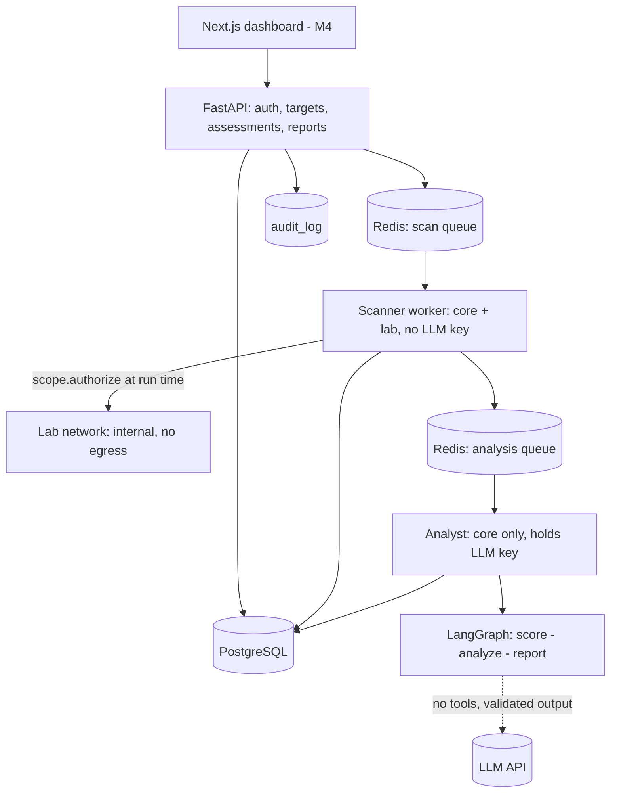

# Architecture

## Trust boundaries
1. **Browser -> API**: JWT bearer, role checks, per-owner isolation.
2. **API -> workers**: jobs carry an id, never a host or command.
3. **Worker -> targets**: scope check at run time; scans the vetted IP.
4. **Scan data -> LLM**: untrusted; sanitized, tool-less, output validated (ADR-006).
5. **Scanner vs analyst**: separate containers and networks (ADR-007).

## Schema
`users` · `targets` · `audit_log` · `assessments` · `scan_results` · `findings` · `reports(assessment_id unique, source, markdown, analysis_json)`
