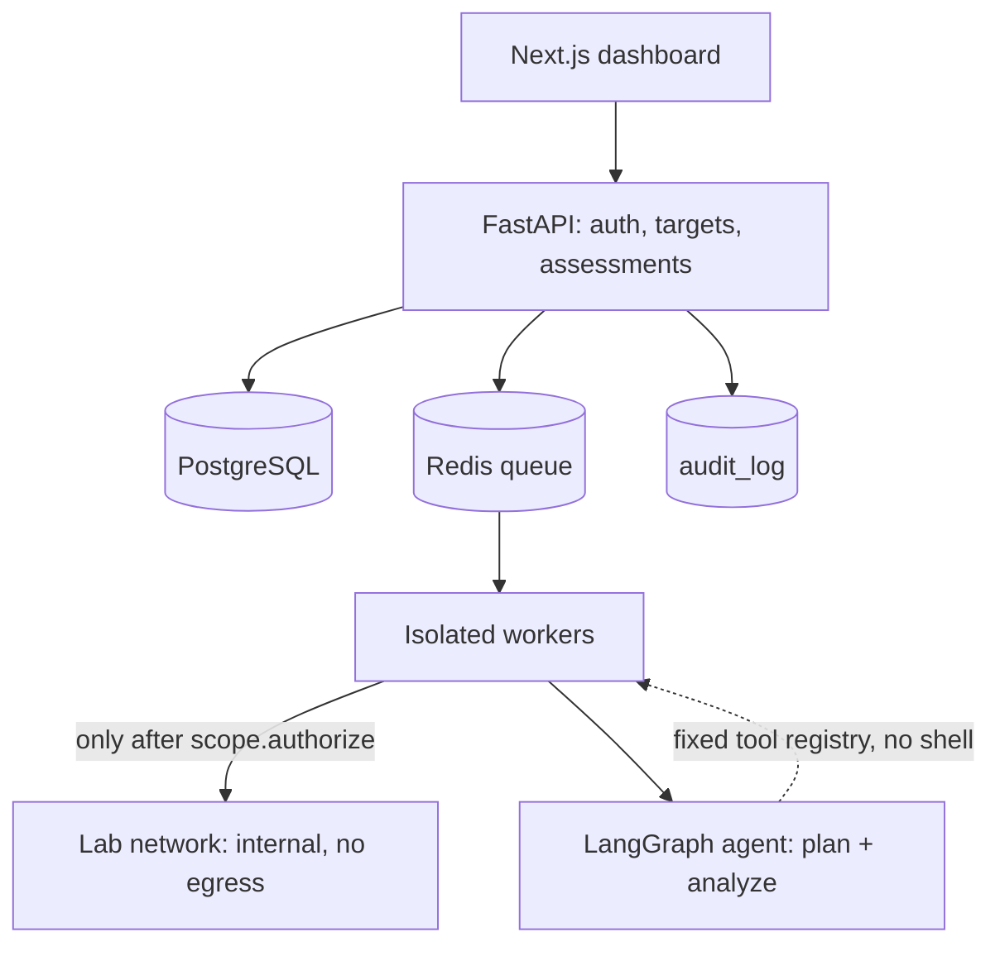

# Architecture

## Trust boundaries
1. **Browser -> API**: JWT bearer, role checks, per-owner resource isolation.
2. **API -> workers**: jobs reference a `target_id`, never a raw host string.
3. **Workers -> targets**: every action passes `core/scope.py` (deny by default).
4. **Agent -> tools**: closed registry of typed actions; no arbitrary commands, no scope expansion.

## Schema (M1)
`users(id, email, password_hash, role)` · `targets(id, owner_id, value, kind, verified, challenge_token)` · `audit_log(id, user_id, action, detail, ts)`
